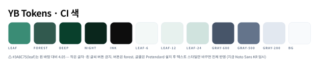
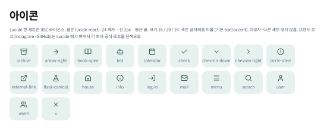
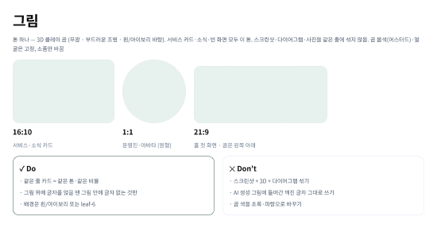

# 1층 · 기초 (Foundations)



---

## 색

### CI · 회색

| 토큰 | 값 | 쓰는 곳 | 흰 바탕 대비 |
|---|---|---|---|
| `leaf` | `#3A8C75` | 대표색 — 큰 제목·아이콘 바탕·장식. **작은 글자·흰 글씨 버튼 금지** | 4.05 |
| `forest` | `#31594E` | 버튼·링크·라벨 | 7.87 |
| `deep` | `#09402C` | 버튼 누름·진한 띠 | 11.79 |
| `night` | `#0A261C` | 어두운 바탕 (푸터·토스트) | 16.07 |
| `ink` | `#0D0D0D` | 제목 | 19.44 |
| `leaf-6` | `#F3F8F7` | 구역 바탕 | — |
| `leaf-12` | `#E7F1EE` | 선택된 메뉴·아이콘 칸 | — |
| `leaf-24` | `#D0E3DE` | 강조 선·장식 | — |
| `gray-600` | `#475569` | 본문 | — |
| `gray-500` | `#64748B` | 보조 글자 | — |
| `gray-200` | `#E2E8F0` | 선·카드 테두리 | — |
| `bg` | `#F8FAFC` | 페이지 바탕 | — |
| `danger` | `#DC2626` | **오류 표시만** (CI 밖 예외) | — |

- 대비는 WCAG 상대휘도 계산값. 본문 기준 4.5 이상
- 밝은 색 3단계 = `leaf` 를 흰색에 6·12·24% 섞은 값
- **곰 머스터드는 곰 그림 안에서만.** 화면 장식·글자·버튼에 쓰지 않음 (2026-10-13 결정)

### 의미 토큰

부품은 CI 이름 대신 **용도 이름**을 씀 → 색을 바꿀 때 용도 단위로 바꿈

| 묶음 | 토큰 → 값 |
|---|---|
| text | `heading`→ink · `body`→gray-600 · `muted`→gray-500 · `accent`→forest · `on-accent`→white · `disabled`→gray-500 |
| surface | `page`→bg · `card`→white · `accent-soft`→leaf-12 · `section-alt`→leaf-6 · `dark`→night · `disabled`→leaf-6 |
| border | `default`→gray-200 · `accent`→forest · `focus`→leaf |
| button | `primary-bg`→forest · `primary-bg-hover`→deep · `primary-bg-pressed`→night · `secondary-bg-hover`→leaf-12 |
| brand | `primary`→leaf |

## 글꼴

| 스타일 | 글꼴 | 크기 / 줄 | 굵기 | 비고 |
|---|---|---|---|---|
| `logo` | Montserrat | 18 / 24 | Bold | YEOBAEK 워드마크 전용 |
| `label` | Montserrat | 12 / 16 | Bold | 영문 대문자 · 자간 0.14em |
| `hero` | Pretendard | 48 / 48 (폰 36 / 40) | Bold | 첫 화면 제목만 — 홈 「Yeobaek Web」 · 모집 홈 「Fill the Margin…」. 자간 −0.025em |
| `title` | Pretendard | 36 / 40 (폰 30 / 36) | Bold | 자간 −0.025em |
| `card-title` | Pretendard | 18 / 28 | Bold | |
| `body` | Pretendard | 14 / 23 | Regular | |
| `body-long` | Pretendard | 16 / 26 | Regular | 긴 글 |
| `button` | Pretendard | 14 / 20 | SemiBold | |

- Montserrat 는 한글이 없음 → 한글 제목에 쓰지 않음
- Inter 는 따로 쓰지 않음 (Pretendard 영문이 Inter 기반)
- 48px 초과 금지. 48 은 첫 화면 제목(`hero`)만 — 모집 홈 크기 기준 (2026-10-13 결정)

```html
<link href="https://fonts.googleapis.com/css2?family=Montserrat:wght@700&display=swap" rel="stylesheet">
<link href="https://cdn.jsdelivr.net/gh/orioncactus/pretendard@v1.3.9/dist/web/variable/pretendardvariable-dynamic-subset.min.css" rel="stylesheet">
```

Pretendard 버전은 붙이기 전에 최신 확인 ❓

## 모양

| 토큰 | 값 | 어디 |
|---|---|---|
| `radius.card` | 16px | 카드·그림·입력칸·모달 |
| `radius.pill` | 9999px | 버튼·태그·배지 |
| `shadow.rest` | `0 1px 2px rgb(0 0 0 / .05)` | 카드 기본 |
| `shadow.hover` | `0 4px 6px -1px rgb(0 0 0 / .1)` | 카드 hover · 모달 · 토스트 |
| 포커스 링 | `leaf` 45% · 3px | 버튼·입력칸 포커스 |

## 간격 · 화면 폭

| 항목 | 값 |
|---|---|
| 내용 폭 | 1024 (`max-w-5xl`) |
| 좌우 여백 | 24 (폰 20) |
| 구역 위아래 | 80 |
| 카드 사이 · 카드 안 | 20 · 24 |

| 화면 | 폭 | 열 | 여백 | 열 간격 |
|---|---|---|---|---|
| PC | 1440 | 12 (내용 1024) | 208 | 20 |
| 태블릿 | 768 | 8 | 24 | 20 |
| 폰 | 390 | 4 | 20 | 16 |

## 아이콘



- **Lucide** 한 세트 (ISC 라이선스) · 웹은 `lucide-react`
- 24 격자 · 선 2px · 둥근 끝 · 크기 16 / 20 / 24 · 색은 글자색을 따름 (기본 `text.accent`)
- Figma 에 컴포넌트 20개: archive · arrow-right · book-open · bot · calendar · check · chevron-down · chevron-right · circle-alert · external-link · flask-conical · house · info · log-in · mail · menu · search · user · users · x
- 이모지·다른 세트 섞지 않음. Instagram·GitHub 는 Lucide 에서 빠짐 → 각 회사 공식 로고 단색

## 그림



- 톤 하나 — **3D 클레이 곰** (무광 · 부드러운 조명 · 흰/아이보리 바탕)
- 비율: 카드 16:10 · 아바타 1:1(원형) · 홈 첫 화면 21:9 (곰은 왼쪽 아래)
- 곰 몸색·얼굴 고정, 소품만 바꿈
- 같은 줄에 스크린샷·3D·다이어그램 섞지 않음 · AI 그림의 깨진 글자 그대로 쓰지 않음
- 카드 밖으로 「튀어나오는」 배치는 **배경 지운(누끼) PNG** 가 있어야 함 — 지금 투명 배경 곰은 1장뿐 (2026-10-13 확인)
