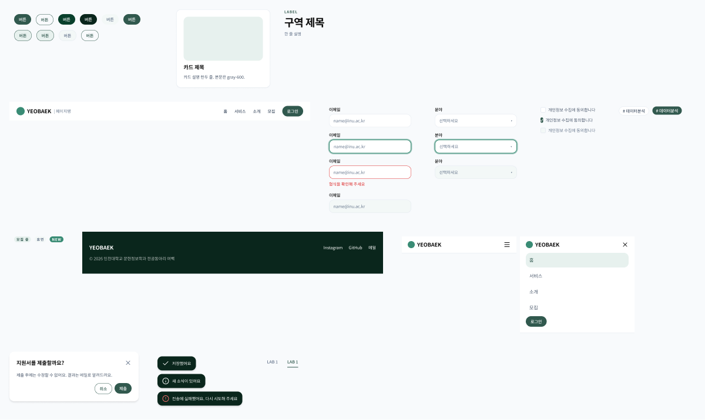

# 2층 · 부품 (Components)

모든 부품은 1층 **의미 토큰**만 씀. 색 코드를 직접 쓰지 않음

---

## 목록

| 부품 | 변형 | 토큰 | Web_page 대응 |
|---|---|---|---|
| Button | Type: Primary · Secondary × State: Default · Hover · Pressed · Disabled · Focus (10) | `button.*` · `border.accent` · `radius.pill` | ❓ 공통 부품 없음 — 만들 것 |
| Card | 기본 · hover(`shadow.hover` + 위로 4px) · 비활성 | `surface.card` · `border.default` · `radius.card` · `shadow.rest` | ❓ 페이지마다 직접 |
| SectionHead | 라벨 + 제목 + 설명 | `label` · `title` · `text.muted` | `SectionHead` (`SiteHeader.jsx`) |
| Header | PC — 로고 · 메뉴 · 로그인 버튼 | `surface.card` · `logo` | `SiteHeader` |
| Header / Mobile | Menu: Closed · Open | 선택된 메뉴 `surface.accent-soft` | ❓ |
| Footer | 로고 · 링크 · 저작권 | `surface.dark` · 흰 글자 | ❓ |
| Input | Default · Focus · Error · Disabled | `border.default` → focus `border.focus` 2px → error `danger` | 모집·가입·로그인 폼 |
| Select | Default · Focus · Disabled | Input 과 같음 + `chevron-down` | 모집 폼 |
| Checkbox | Off · On · Disabled | On = `button.primary-bg` | 가입 동의 |
| Tag | Default · Selected | Selected = `button.primary-bg` + 흰 글자 | `TagSelector` |
| Badge | Accent(모집 중) · Dormant(휴면) · New | `surface.accent-soft` · `surface.disabled` · `brand.primary` | LAB 휴면 표시 |
| Modal | 제목 · 닫기 · 본문 · 버튼(오른쪽 정렬) | `surface.card` · `shadow.hover` · 덮개 night 40% | ❓ |
| Toast | Success · Info · Error | `surface.dark` · 흰 글자 · 아이콘 | ❓ |
| Tab | Default · Selected | 선택 = `text.accent` + 밑줄 2px | LAB 1~6 · 모집 공고/인력풀 |

❓ = 지금 Web_page 에 공통 부품이 없음 → 홈 PR 때 같이 만듦

## 부품별 규칙

### Button
- 주 버튼(Primary)은 **한 화면에 하나**. 나머지는 Secondary
- 글자는 동사 — 제출 · 저장 · 모집 보기. 「여기를 클릭」 금지
- `<button>` 또는 `<a>`. `div onClick` 금지
- 포커스 링은 키보드 이동 때 꼭 보이게

### Card
- 같은 줄 카드 = 같은 높이 · 같은 그림 비율(16:10)
- 누를 수 있는 카드만 hover 효과
- 카드 안에 카드 금지 · 카드마다 다른 색 테두리 금지

### Header
- **모든 페이지 같은 헤더 하나** (모집·운영 포함). 현재 페이지 메뉴 표시
- 폰은 햄버거(`menu` 아이콘) → 열면 세로 메뉴 + 로그인 버튼

### Input · Select · Checkbox
- 라벨은 칸 **위에 항상**. placeholder 를 라벨 대신 쓰지 않음
- 오류는 칸 아래 한 줄, `danger` 색. 오류 표시는 빨강만
- 비활성은 `surface.disabled` 바탕 + `text.disabled`

### Tag · Badge
- Tag 는 누름(필터·선택), Badge 는 표시만
- Badge 색은 3종을 넘지 않음
- ⚠️ New 배지(`leaf` 바탕 흰 12px 글자)는 대비 4.05 로 기준 미달 → 쓸지 판단 필요 ❓

### Modal
- 되돌릴 수 없는 일 확인용만 (제출 · 삭제)
- 주 버튼이 맨 오른쪽. 모달 위에 모달 금지

### Toast
- 화면 아래 가운데, 3초 후 사라짐. 결과 한 줄 (「저장했어요」)
- 중요한 오류는 토스트만으로 끝내지 않고 화면에도 남김

### Tab
- 같은 페이지 안 전환만. 페이지 이동은 링크
