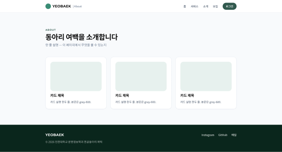
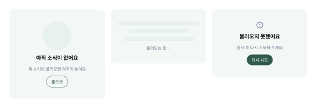
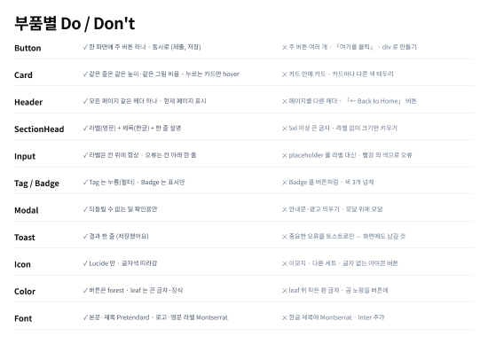

# 3층 · 패턴 (Patterns)

---

## 하위 페이지 틀



```
Header (공통)
PageHead   라벨(영문) · 제목 · 한 줄 설명      위 80 · 아래 48
본문        카드 3열 (폰 1열) · 사이 20         아래 80
Footer (공통)
```

- 소개 · 전시 · 아카이빙 · LAB · 모집 모두 이 틀에서 시작
- 「← Back to Home」 버튼 없음 — 헤더 로고·「홈」 메뉴로 충분

## 홈

- 순서: 첫 화면 → 숫자 → 서비스 → 소식 → 문의 (Web_page `DESIGN.md` 6절)
- **첫 화면은 지금 `src/theme.json` 설정 그대로** — 계절 배경 그림 · 곰 왼쪽 아래 · 글자 오른쪽. 버튼만 Button 부품으로 (2026-10-13 결정)
- 숫자는 확인된 값만 — 운영 사이트 기준 4 LAB · 3 서비스 · 2022 창립 · 8 부원 (2026-10-13 캡처)
- 서비스 카드 그림은 카드 윗칸에 꽉 채움 (곰이 상자 안에 떠 보이지 않게)
- ❓ 꾸밈 단계 스위치 — `theme.json` 에 「꾸밈: 홈만 / 전체」 를 두고, 「전체」 면 하위 페이지 머리에도 곰 + 곡선. 곰 그림이 없는 페이지는 차분한 틀로 대체. 시안 진행 중

## 빈 화면 · 로딩 · 오류



| 상태 | 구성 | 문구 예 |
|---|---|---|
| 빈 화면 | 곰 그림 · 제목 · 한 줄 · 보조 버튼 | 아직 소식이 없어요 / 홈으로 |
| 로딩 | 회색 줄(스켈레톤) 3개 · 「불러오는 중…」 | — |
| 오류 | `circle-alert` · 제목 · 한 줄 · 주 버튼 | 불러오지 못했어요 / 다시 시도 |

- 바탕 `surface.section-alt` · 모서리 `radius.card`
- 「준비 중」 페이지도 빈 화면 패턴으로 (지금 `wait.png` 「COMING SOON」 대체)

## 부품별 Do / Don't



| 부품 | ✓ Do | ✕ Don't |
|---|---|---|
| Button | 한 화면에 주 버튼 하나 · 동사로 | 주 버튼 여러 개 · 「여기를 클릭」 · div 로 만들기 |
| Card | 같은 줄은 같은 높이·같은 그림 비율 · 누르는 카드만 hover | 카드 안에 카드 · 카드마다 다른 색 테두리 |
| Header | 모든 페이지 같은 헤더 · 현재 페이지 표시 | 페이지별 다른 헤더 · 「← Back to Home」 |
| SectionHead | 라벨(영문) + 제목(한글) + 한 줄 설명 | 48px 이상 · 라벨 없이 크기만 키우기 |
| Input | 라벨은 칸 위 · 오류는 칸 아래 한 줄 | placeholder 를 라벨 대신 · 빨강 외 오류색 |
| Tag / Badge | Tag 는 누름 · Badge 는 표시 | Badge 를 버튼처럼 · 색 3개 넘게 |
| Modal | 되돌릴 수 없는 일 확인만 | 안내·광고 띄우기 · 모달 위에 모달 |
| Toast | 결과 한 줄 | 중요한 오류를 토스트로만 |
| Icon | Lucide 만 · 글자색 따라감 | 이모지 · 다른 세트 · 글자 없는 아이콘 버튼 |
| Color | 버튼은 forest · leaf 는 큰 글자·장식 | leaf 위 작은 흰 글자 · 곰 노랑을 화면 장식에 |
| Font | 본문·제목 Pretendard · 로고·영문 라벨 Montserrat | 한글 제목에 Montserrat · Inter 추가 |
